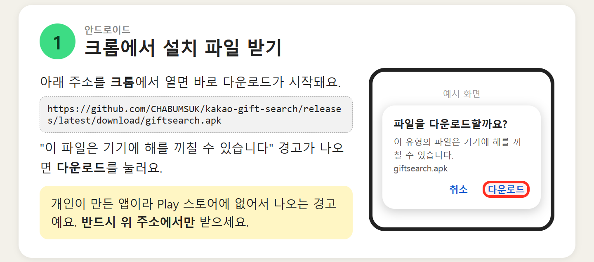
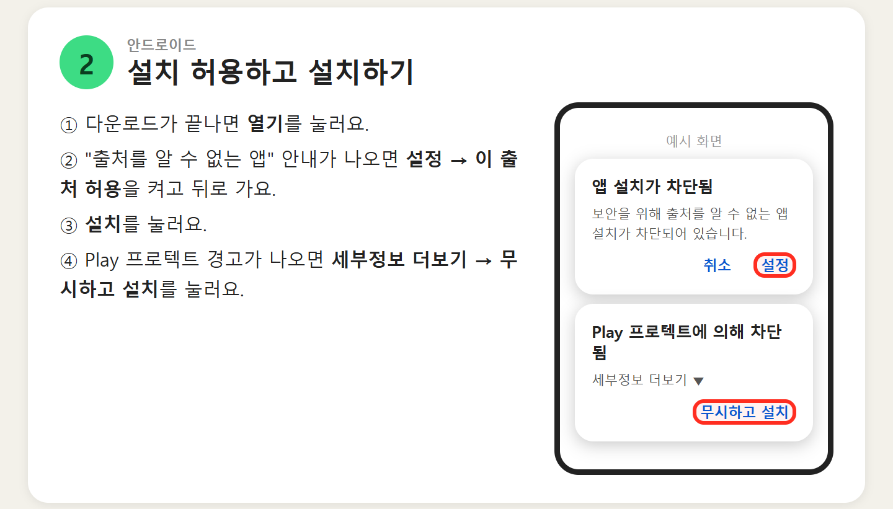
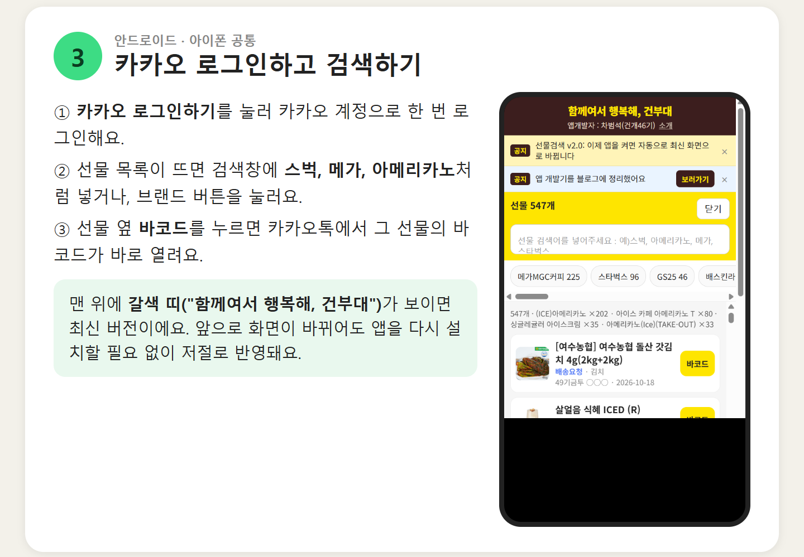
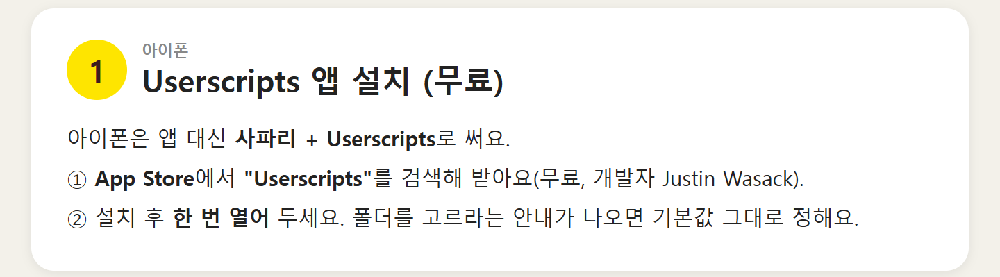
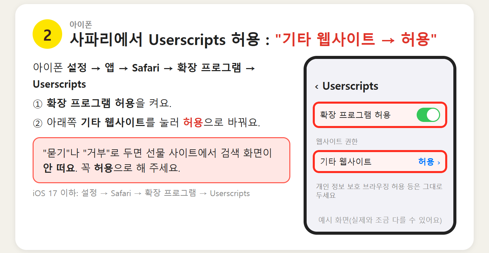
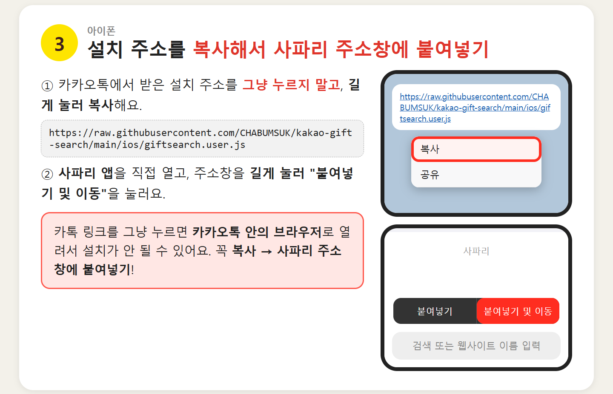
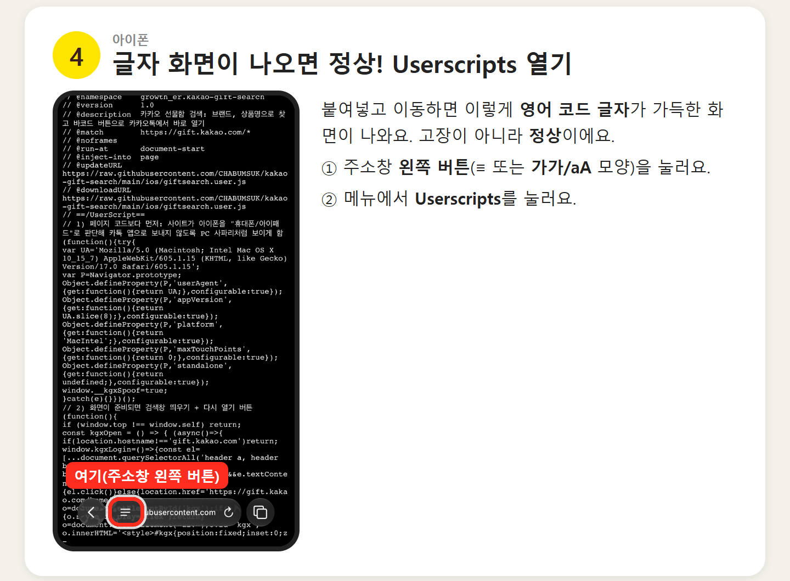
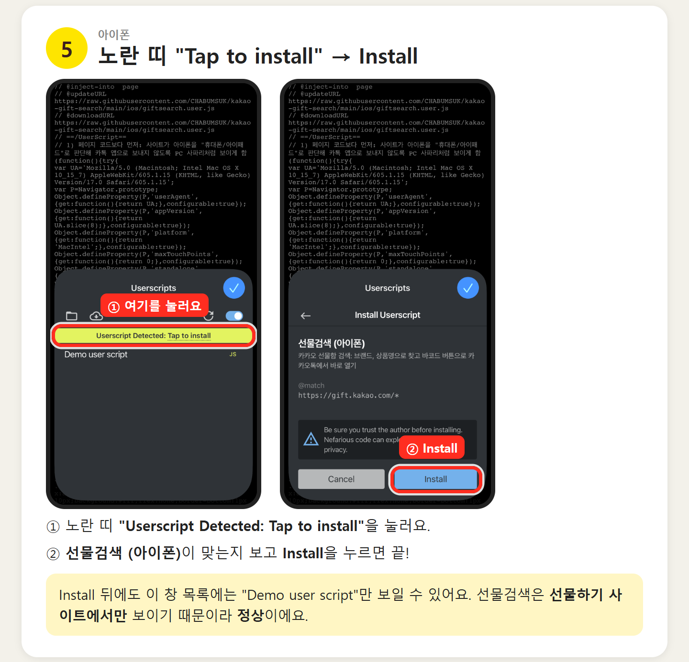
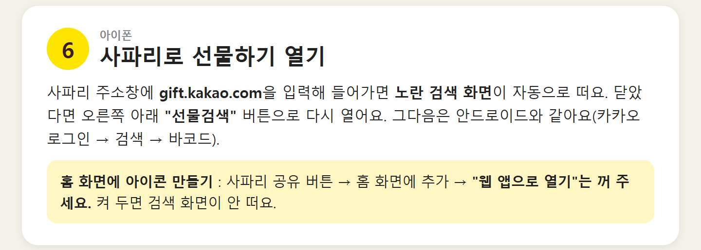
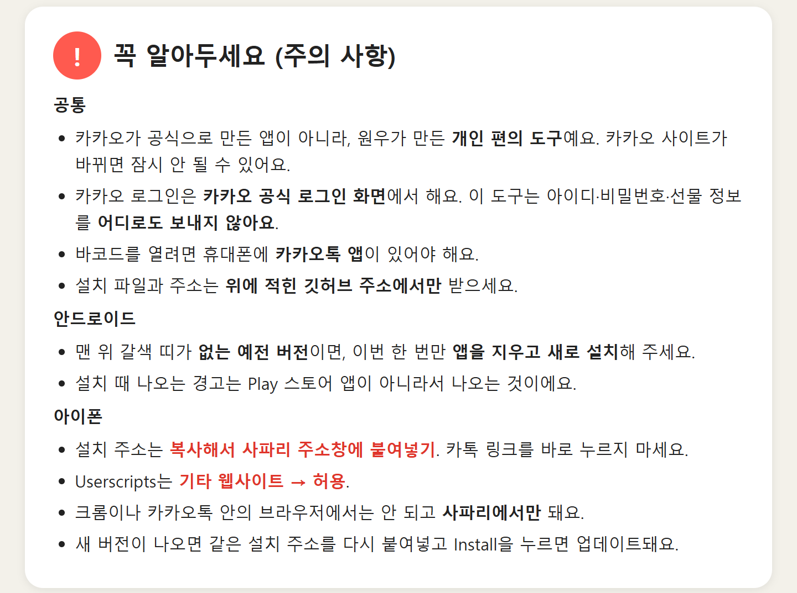

# 선물검색 (카카오 선물함 검색)

**함께여서 행복해, 건부대** · 앱개발자 : 차범석(건개46기)

카카오톡 선물함의 선물을 브랜드·상품명으로 찾고, **바코드** 버튼 한 번으로 카카오톡에서 그 선물의 바코드를 여는 개인 편의 도구예요.

- 안드로이드(갤럭시) : 앱(APK) 설치
- 아이폰 : 사파리 + 무료 앱 Userscripts


---

## 안드로이드 설치

설치 파일 주소 (크롬에서 열기)

```
https://github.com/CHABUMSUK/kakao-gift-search/releases/latest/download/giftsearch.apk
```

1. 위 주소를 **크롬**에서 열고, 경고가 나오면 **다운로드**를 눌러요.
2. 다운로드가 끝나면 **열기** → "출처를 알 수 없는 앱"이면 **설정 → 이 출처 허용** 켜기 → 뒤로.
3. **설치** → Play 프로텍트 경고가 나오면 **세부정보 더보기 → 무시하고 설치**.
4. 앱을 열고 **카카오 로그인하기**로 한 번 로그인하면 끝.





---

## 아이폰 설치

설치 주소

```
https://raw.githubusercontent.com/CHABUMSUK/kakao-gift-search/main/ios/giftsearch.user.js
```

1. App Store에서 무료 앱 **Userscripts**(개발자 Justin Wasack)를 받고 한 번 열어요.
2. **설정 → 앱 → Safari → 확장 프로그램 → Userscripts** → 확장 프로그램 허용 켜기, **기타 웹사이트 → 허용**.
3. 설치 주소를 **길게 눌러 복사** → **사파리 주소창에 붙여넣기 및 이동**. (카톡 링크를 그냥 누르지 마세요.)
4. 코드 글자 화면이 나오면 정상 → 주소창 왼쪽 버튼 → **Userscripts**.
5. 노란 띠 **"Userscript Detected: Tap to install"** → **Install**.
6. 사파리 주소창에 **gift.kakao.com** → 노란 검색 화면 → 카카오 로그인.








---

## 주의 사항



- 카카오 공식 앱이 아닌 개인 편의 도구예요. 카카오 선물하기 사이트가 바뀌면 동작이 멈출 수 있어요.
- 로그인은 카카오 공식 로그인 화면에서 하고, 이 도구는 아이디·비밀번호·선물 정보를 어디로도 보내지 않아요.
- 바코드를 열려면 카카오톡 앱이 있어야 해요.
- 설치 파일과 주소는 이 저장소에서만 받으세요.
- 안드로이드 : 맨 위 갈색 띠가 없는 예전 버전이면 한 번만 지우고 새로 설치해요. 이후 화면 변경은 앱을 켤 때 자동 반영돼요.
- 아이폰 : 사파리에서만 동작해요. 새 버전은 같은 설치 주소를 다시 붙여넣고 Install을 누르면 업데이트돼요.

## 공지 바꾸기 (개발자용)

`notice.json`을 고치면 다시 설치 없이 안드로이드·아이폰 화면 상단 공지와 개발자 소개 카드가 바뀌어요.
